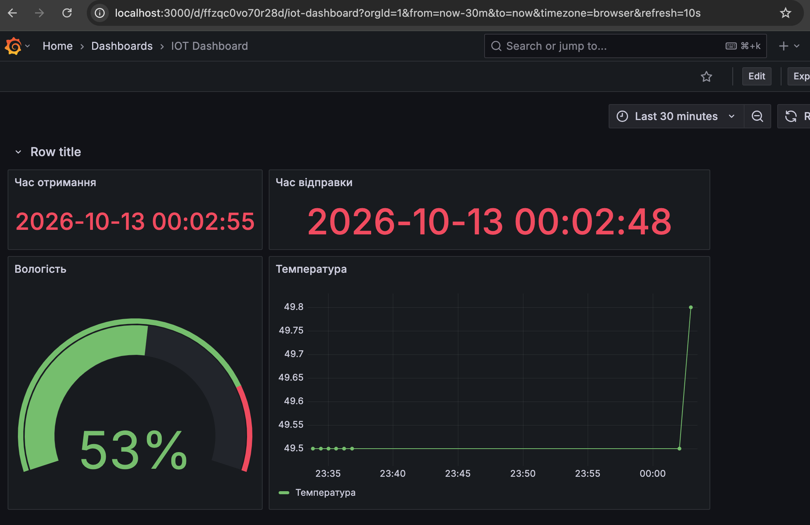
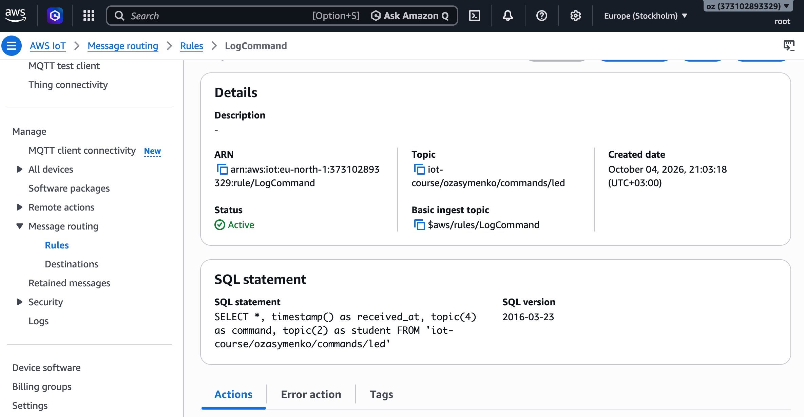
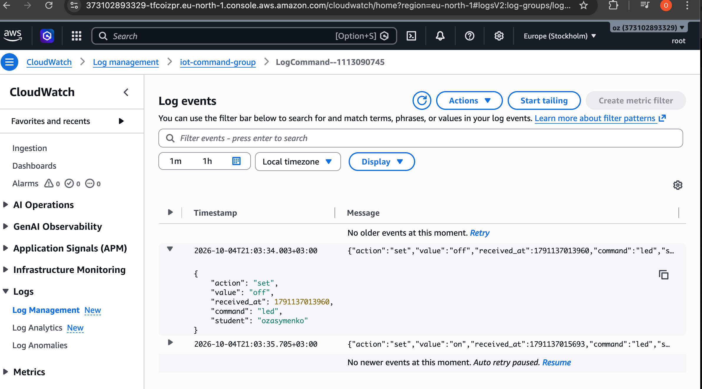

# Домашня робота 6 — FastAPI: бекенд, що не тільки читає, а й командує

Три частини, що працюють разом: пристрій публікує телеметрію в хмару,
бекенд її читає й показує, і той самий бекенд може послати пристрою команду
назад. Деталі кожної частини — у власному README (`ESP32/README.md`,
`FastAPI/README.md`, `HTML/README.md`); тут — загальна картина, список
ресурсів AWS і те, що ще не зроблено.

---

## Архітектура (обидва напрямки)

```
        ↓ КОМАНДИ (вниз)                ↑ ТЕЛЕМЕТРІЯ (вгору)

┌─────────────────┐
│  Браузер        │  HTML/index.html
│  [Увімкнути]    │
└────────┬────────┘
         │ POST /actuators/led  {"value":"on"}
         │ HTTP + CORS
         ▼
┌─────────────────────────────────────────┐
│  FastAPI  :8000                         │  ← GET /sensors/latest
│  main.py · iot_client.py · db.py        │<--┌─────────────────┐
└────────┬───────────────────────▲────────┘   │  Grafana        │ 
         │ boto3 iot-data        │boto3 query │  [infinity]     │
         │ publish  QoS 1        │            └─────────────────┘
         ▼                       │
┌─────────────────┐     ┌────────┴────────┐
│  AWS IoT Core   │     │  DynamoDB       │
│                 │     │  iot_telemetry  │
└──────▲─┬────────┘     └────────▲────────┘
       │ │                       │
topic: │ │ topic:                │ Rules Engine
/events│ │ .../commands/led      │ (Заняття 11)
       │ │                       │
       │ │ MQTT over TLS :8883   │ topic: .../sensors/data
       │ ▼                       │
┌────────────────────────────────┴───────┐
│  ESP32 (Wokwi)                         │
│  subscribe → LED D2   Deep Sleep 60 с  │
└────────────────────────────────────────┘
```

Два незалежні канали: «вгору» (телеметрія: пристрій → Rule → DynamoDB →
FastAPI → браузер/Grafana) і «вниз» (команда: браузер → FastAPI → AWS IoT →
пристрій → подія назад). Жодна частина не знає адреси іншої — спільна точка
це назва топіка/таблиці, а не IP чи URL.

Grafana — третій, окремий споживач «вгору»-каналу: вона не читає
DynamoDB/AWS напряму, а через ті самі `GET /sensors/latest` і
`GET /sensors/history`, що й міг би будь-який інший клієнт.

---

## Структура репозиторію

```
ESP32/     — прошивка (PlatformIO, модулі: net, mqtt, dht, ldr, led, button, ota, wdt)
           — version.h, partitions.csv, merge_firmware.py, job.json(.README.md) — OTA
FastAPI/   — бекенд: читання DynamoDB + публікація команд в AWS IoT
HTML/      — одна сторінка з двома кнопками (Увімкнути / Вимкнути)
grafana/   — dashboard.json для імпорту в Grafana
```

---

## Ресурси AWS

| Ресурс | Назва/ARN | Де використовується |
|---|---|---|
| Thing | `esp32-zasymenko` | ESP32, сертифікат X.509 |
| IoT Policy (на сертифікаті) | `Connect` (по `${iot:Connection.Thing.ThingName}`) + `Publish` на `topic/iot-course/ozasymenko/*` + `Subscribe`/`Receive` на `.../commands/*` | підключення, телеметрія і прийом команд — деталі в `ESP32/README.md` |
| Rules Engine | `StoreTelemetry` (→ DynamoDB), `TemperatureMoreThan28` (→ CloudWatch), `LogCommand` (→ CloudWatch) | записує телеметрію, лог температурних подій, лог команд |
| IAM-роль для Rule | `iot_write_db` | `dynamodb:PutItem` + запис помилок у CloudWatch Logs |
| DynamoDB таблиця | `iot_telemetry` (pk `device_id`, sk `received_at`) | зберігає телеметрію |
| CloudWatch Log Groups | `iot_db_store_errors`, `temperatureLogGroup`, `iot-command-group` | помилки Rule / температурні події / лог усіх команд |
| IAM-користувач (FastAPI, `.env`) | `dynamodb:Query` на `table/iot_telemetry` + `iot:Publish` на `topic/iot-course/ozasymenko/commands/*` | читання телеметрії й публікація команд із бекенда |
| MQTT топік команд | `iot-course/ozasymenko/commands/led` | FastAPI публікує, ESP32 підписується |
| MQTT топік подій | `iot-course/ozasymenko/events` | ESP32 публікує після виконання команди (`{"event":"led_changed",...}`), підтверджуючи результат |
| MQTT топіки робіт (OTA) | `$aws/things/esp32-zasymenko/jobs/{notify-next,$next/get,$next/get/accepted,*/update}` | зарезервовані AWS; пристрій слухає нотифікацію й документ, запитує й звітує |
| Presigning-роль (S3) | `s3:GetObject` на бакет з прошивкою, довіра до `iot.amazonaws.com` | перетворює плейсхолдер у `job.json` на presigned URL — деталі в `ESP32/job.json.README.md` |

**SQL правила `StoreTelemetry`** (кладе телеметрію в DynamoDB — саме звідси
`received_at`, за яким `db.py` робить query):

```sql
SELECT *, timestamp() as received_at, clientid() as client_id, topic(2) as student
FROM 'iot-course/ozasymenko/sensors/data'
```

---

## Як запустити

### ESP32 (PlatformIO / Wokwi)

```bash
cd ESP32
cp src/secrets.example.h src/secrets.h   # заповнити своїми значеннями
# залити сертифікати, THINGNAME, AWS_IOT_ENDPOINT
pio run                                   
```
Запустити Wokwi симулятор


### FastAPI (:8000)

```bash
cd FastAPI
python -m venv .venv && source .venv/bin/activate
pip install -r requirements.txt
cp .env.example .env                      # заповнити AWS-ключами й регіоном
uvicorn main:app --reload
```

Swagger UI: http://127.0.0.1:8000/docs

### Grafana



Дашборд читає JSON напряму з FastAPI — без окремого проміжного API чи БД
на боці Grafana.

**Запуск (macOS):**

```bash
brew install grafana
brew services start grafana
# відкрити http://localhost:3000, логін admin / admin
```

1. Встановити плагін **Infinity** (`yesoreyeram-infinity-datasource`):
   `grafana-cli plugins install yesoreyeram-infinity-datasource` (або через
   UI: Connections → Add new connection → Infinity), і додати джерело даних
   цього типу (URL можна лишити порожнім — він заданий у кожному панелі
   окремо).
2. **FastAPI має вже бути запущений на :8000** — Grafana ходить за живими
   даними в момент рендеру панелі, нічого не кешує сама.
3. Dashboards → Import → завантажити `grafana/dashboard.json`.

Чотири панелі, усі на `GET /sensors/latest` (три) і
`GET /sensors/history?minutes=30` (одна):

| Панель | Тип | Джерело |
|---|---|---|
| Час отримання | stat | `received_at` з `/sensors/latest` |
| Вологість | gauge | `humidity` з `/sensors/latest` |
| Час відправки | stat | `timestamp` з `/sensors/latest` |
| Температура | timeseries | `received_at`+`temperature` з `/sensors/history?minutes=30` |

Автооновлення — `refresh: 30s`, часове вікно — `now-30m` до `now`.

---


### HTML

Відкрити `HTML/index.html`, що звертається до backend-у на `http://localhost:8000`.
Натискаємо кнопку "Увімкнути".

На html-сторінці виводиться відповідь самого FastAPI (не MQTT, браузер
MQTT не бачить):

```
202
{"accepted":true,"value":"on"}
```

Це підтверджує лише доставку команди до брокера AWS IoT — не те, що
світлодіод реально загорівся.

ESP32 (`led.cpp`) отримує команду, вмикає світлодіод і одразу публікує
подію назад у хмару — на спільний топік подій пристрою
**`iot-course/ozasymenko/events`**:

```
Serial: "[CMD] LED увімкнено"
MQTT → iot-course/ozasymenko/events:
{"event":"led_changed","value":"on"}
```

Топік спільний для різних типів подій (не лише LED) — тип несе поле
`event` у payload, а не назва топіка чи окремий підтопік під командами.

Побачити цю подію можна в AWS IoT Console → MQTT test client, підписавшись
на `iot-course/ozasymenko/events` — саме вона, а не `202` від FastAPI, і є
доказом, що світлодіод реально змінив стан.

---

## OTA (AWS IoT Jobs)

Пристрій уміє оновити сам себе: AWS IoT Jobs доставляє документ роботи по
MQTT, ESP32 якає новий образ по HTTPS з S3, пише його у вільний OTA-слот
(`partitions.csv` — два слоти, `app0`/`app1`) і перезавантажується вже в
нову версію. `version.h` — єдине джерело правди про поточну версію;
`firmware_version` з нього потрапляє і в телеметрію.

### Що для цього потрібно в AWS (окрім Policy пристрою з таблиці вище)

1. **Підписки/публікації на job-топіки** додаються в ту саму Policy
   пристрою — `Subscribe`/`Receive` на `notify-next` і
   `$next/get/accepted`, `Publish` на `$next/get` і `*/update`.
2. **Presigning-роль** — окрема IAM-роль (не Policy пристрою!), яку AWS IoT
   приміряє, щоб перетворити плейсхолдер `${aws:iot:s3-presigned-url-v2:...}`
   у `job.json` на робоче посилання. Trust policy, permissions policy і
   куди саме її підключати (`presignedUrlConfig.roleArn` у `CreateJob`,
   не в сам `job.json`) — усе в `ESP32/job.json.README.md`.

### Як випустити нову версію

Порядок критичний — спершу те, що їде **в бакет**, і аж потім те, що
лишається **в чіпі**:

1. `version.h` → `FIRMWARE_VERSION "1.1.0"`
2. Зібрати (`pio run`), залити `.pio/build/esp32dev/firmware.bin`
   (**не** `merged.bin` — у ньому на позиції 0 padding/bootloader, не
   `0xE9`, `Update` одразу падає з `Wrong Magic Byte`/`Decryption error`)
   у S3 під іменем з `job.json`, звірити розмір файлу з консоллю S3.
3. `version.h` → назад на `"1.0.0"` — це тепер «старий» пристрій, який
   зараз оновиться.
4. Зібрати ще раз, **перезапустити** симулятор — Wokwi підхоплює новий
   `merged.bin` лише при старті (`wokwi.toml` вказує саме на нього, не
   на голий `firmware.bin` — інакше OTA-слоти не видно).
5. Оновити `version` у `job.json`, покласти в S3, створити Job з новим
   `jobId` (попередню роботу вже закрито як `SUCCEEDED` — пристрій до неї
   не повернеться).

**Найпідступніша помилка — забути крок 1.** Якщо `firmware.bin`, залитий
у S3, зібраний зі старим `version.h`, пристрій якає, пише, перезавантажується
(увесь механізм відпрацьовує!), але `FIRMWARE_VERSION` у новому образі
все одно `"1.0.0"` — не збігається з `version` у `job.json` → робота не
закривається → пристрій якає ту саму «нову» версію по колу нескінченно.
Перевіряється одним рядком у Serial після оновлення: має бути
`розділ app1` і правильна версія в `ESP32 — OTA, версія ...`.

### Діагностика

- `розділ app1` + причина ресету `8` (DEEPSLEEP) → оновились **або** просто
  прокинулись за таймером — після Deep Sleep причина 8 неоднозначна,
  розрізняти по `розділ`/версії, а не по самій причині (див. `## Deep Sleep`).
- `розділ app0` після оновлення → відкотились (MQTT не піднявся до того,
  як пристрій заснув/відключився, або прошивка впала на старті).
- `[OTA] Образ підтверджено — rollback скасовано` у Serial — доказ, що
  rollback більше не спрацює; без цього рядка оновлення ще не прийняте
  назавжди. Викликається одразу після вдалого MQTT-конекту, **до** сну —
  окремого таймера очікування тут більше немає: пробудження саме по собі
  є ресетом, і bootloader сам відкотить непідтверджений образ на
  наступному циклі, якщо ми не встигли підтвердити.
- Повний перелік симптомів і причин — `ESP32/job.json.README.md` і
  коментарі в `src/ota/ota.cpp`.

---

## Deep Sleep

Пристрій спить більшість часу — прокинувся, зробив усе за один прохід
`work_cycle()`, заснув на `SLEEP_SECONDS` (60с). **Уся програма living в
`setup()`**: `loop()` недосяжний у нормальному житті, крутиться лише як
страховка, якщо йде OTA й заснути не можна.

### Один цикл

1. `mqtt_begin()` + `mqtt_connect()` — якщо не вдалось (нема Wi-Fi чи MQTT) —
   одразу спати, без повторних спроб у цьому ж пробудженні. Наступна
   спроба — наступне пробудження.
2. Підтвердження OTA-образу (`esp_ota_mark_app_valid_cancel_rollback()`) —
   одразу після конекту, до будь-чого іншого.
3. `mqtt_wait_for_job(2000)` — активно чекаємо (не `delay()`, той не читає
   сокет) відповідь про роботу; той самий цикл заразом ловить і
   LED-команду, якщо вона прилетіла в це вікно.
4. Читання DHT22/LDR і публікація телеметрії (один раз за цикл).
5. Обробка команди, якщо прийшла.
6. `go_to_sleep()`.

### Що переживає сон

```cpp
RTC_DATA_ATTR int bootCount = 0;
```

`RTC_DATA_ATTR` кладе змінну в RTC-памʼять — єдине, що лишається під
живленням у Deep Sleep. Переживає **пробудження**, але не **ресет** (кнопка
reset, втрата живлення) — тоді `bootCount` знову `0`. Це найшвидший спосіб
у Serial відрізнити «прокинулись» від «перезавантажились».

### Чому без `wdt/` сну немає в Wokwi

Симулятор зупиняє CPU на час сну, але таймери watchdog-груп тикають і далі
— без `wdt_silence_for_sleep()` замість `DEEPSLEEP_RESET` (причина 8)
прилітає `TG1WDT_SYS_RESET` (причина 5) за ~0.3с. На реальній платі цей
виклик нічого не змінює (RTC знімає живлення раніше, ніж встигне спрацювати
watchdog) — він існує виключно заради симулятора. Повний розбір із
арифметикою регістрів — `src/wdt/wdt.cpp`.

### Свідоме обмеження: команди під час сну губляться

LED-команда (`/commands/led`) доходить, лише якщо її опублікували саме у
вузьке вікно активності (кроки 3-5 вище, ~2-3с). Усе надіслане, поки
пристрій спить, — втрачено: стан LED між циклами **не зберігається і не
відновлюється**. Це усвідомлений наслідок переходу на Deep Sleep без
Device Shadow — надійне керування сплячим пристроєм вимагає моделі
«стан, що лежить і чекає» (AWS IoT Device Shadow), а не події, яку
читає лише той, хто зараз слухає.

### Побічний ефект для експоненційного backoff

`mqtt_reconnect_tick()`/`reconnectInterval` у `mqtt.cpp` лишились у коді,
але більше **нікуди не викликаються** — у новій моделі retry це просто
наступне пробудження, а не повторні спроби всередині одного активного
вікна. Мертвий код, не видаляв навмисно (а раптом знадобиться для
«завжди ввімкненого» режиму) — скажи, якщо прибрати.

---

## Лог команд (CloudWatch)

Окреме Rule `LogCommand` слухає топік команд і пише кожну вхідну команду в
CloudWatch Logs — незалежний від Serial Monitor і топіка подій аудит того,
що саме й коли було надіслано пристрою.

### CommndLogRule



Rule `LogCommand`, `FROM 'iot-course/ozasymenko/commands/led'`:

```sql
SELECT *, timestamp() as received_at, topic(4) as command, topic(2) as student
FROM 'iot-course/ozasymenko/commands/led'
```

`topic(4)`/`topic(2)` беруть сегменти з назви топіка
(`iot-course/ozasymenko/commands/led` → сегмент 2 = `ozasymenko`, сегмент 4 =
`led`) — так до запису додаються `student` і `command` без хардкоду в самому
payload. Дія Rule — запис у CloudWatch Logs, група `iot-command-group`.

### CommandLogs



Результат у CloudWatch Logs (`iot-command-group` → `LogCommand--...`):

```json
{"action":"set","value":"off","received_at":1791137013960,"command":"led","student":"ozasymenko"}
{"action":"set","value":"on","received_at":1791137015693,"command":"led","student":"ozasymenko"}
```

Кожне натискання кнопки на HTML-сторінці лишає тут свій слід — ще один,
незалежний від ack пристрою, доказ того, що команда дійшла до AWS IoT Core.

Аналогічно з вимиканням світлодіода.

[Демонстрація роботи (запис екрана)](<ESP32/images/Screen Recording 2026-10-03 at 23.08.35.mov>)